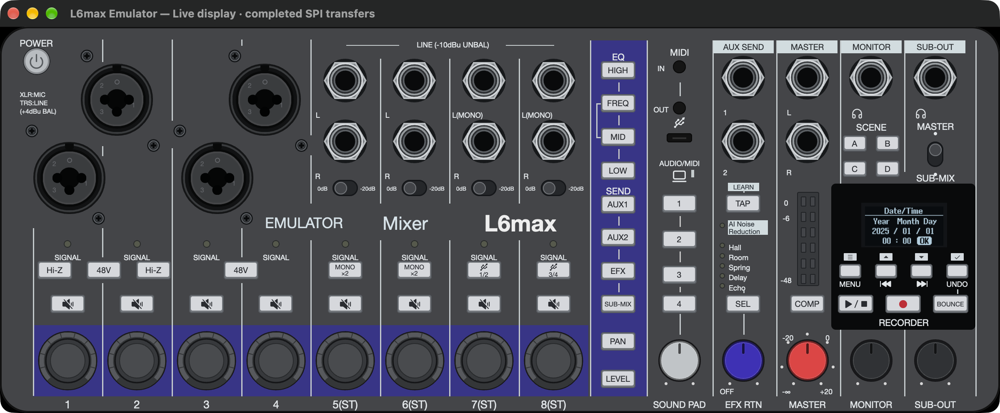

# L6 / L6max Emulator

An independently written emulator, firmware toolkit, and MIDI editor for the ZOOM
LiveTrak L6 and L6max. Run either model's original firmware in a native mixer
UI, investigate its hardware interfaces, and build reproducible firmware patches.



## What you can do

- Run both firmware images in a custom QEMU machine, with GPIO controls,
  firmware-rendered display output, and hardware-driven indicator LEDs.
- Use persistent flash, RTC settings, and an SD card with generated sample WAVs.
- Exercise firmware updates with a replacement installer for the unavailable
  main bootloader.
- Unpack and repack L6 and L6max firmware packages. Build the L6 `midi-sync`
  patch or the supported L6max patches from the detected firmware model.
- Explore the mapped MIDI protocols or use the separate [Zoomie editor](docs/editor.md).

Audio processing and USB audio streaming are not implemented. USB MIDI uses
CoreMIDI on macOS and the ALSA sequencer on Linux, both behind one interface; SD file access uses a CLI rather than Finder mounting.
See [L6/L6max compatibility](docs/guides/model-compatibility.md),
[current model limits](docs/emulator/board.md#limitations), and
[USB coverage](docs/emulator/usb.md#current-limits).

For development, start with [AGENTS.md](AGENTS.md), then check
[current status](docs/development/current-status.md) and the
[consolidated test driver](docs/development/testing.md). The repository
instructions link the workflow and record rules for local firmware, fixtures,
and evidence.

Use the `l6test` driver for repeatable checks and qualification; use
[`l6dbg`](docs/development/diagnostics.md) for focused observations while
investigating behavior. The [tool index](docs/development/tools.md) links to
other package and emulator utilities.

## Quick start

For a packaged build, open the app and choose your firmware with **Select
firmware…**. **File → Open Firmware…** switches packages. See the
[macOS app guide](docs/guides/macos-app.md) for building the bundle and its
current distribution status. Tagged releases publish an Apple silicon app ZIP
and matching dependency sources through [GitHub Actions](docs/development/ci.md).

The established development environment is macOS with Xcode and its Metal
Toolchain, Rust through rustup, and QEMU build dependencies. Supply the stock
L6 or L6max 1.10 firmware yourself; **QEMU 11.1.2** is pinned as a Git submodule.
On Linux, follow the [Linux guide](docs/guides/linux.md) for packages, the
verified scope and the x86_64 AppImage (headless host, tools, patches and live ALSA
ports are verified; the native UI needs a Wayland session).
The [getting started guide](docs/getting-started.md) explains prerequisites,
setup, controls, persistent state, and troubleshooting.

Put `L6.BIN` or `L6max.bin` in the repository root (both are git-ignored), then
run from the repository root:

```sh
cargo run -p l6max-gui
```

The first run fetches the pinned QEMU submodule, builds QEMU with the shared L6/L6max board
(several minutes) and unpacks the package into `emulator/state/firmware/`. Later
runs reuse both, and QEMU rebuilds itself when the board model changes. Every
binary in the workspace does the same, so `cargo run -p l6max-host` and the
  test tools need no setup commands. Use `--firmware-package FILE` or
`L6_FIRMWARE=FILE` for a package elsewhere, `--qemu PATH` for your own build,
and `--no-auto-setup` to disable all of this.

On first L6max launch, complete Date/Time and Battery Type setup using the
panel buttons. The L6 UI has verified hit targets for its six mutes, MONO and
USB source keys, channel modes, COMP, EFX SEL, phantom power, scenes, Record,
TAP, and four sound pads. It also draws Play/Stop, mapped to active-low GPIO2.25
and runtime event `0x20`; successful playback and physical lamp correlation
remain unverified. The L6 has no screen, so first-boot setup and
menu navigation remain incomplete; encoder changes have no LCD readback. Some
unassigned panel matrix coordinates and downstream effects remain under
investigation. Both models create and reuse model-specific demo SD cards and
persistent device state in `emulator/state/`.

For a disposable headless run:

```sh
cargo run -p l6max-host -- --volatile --seconds 10
```

## Documentation

| Start here | What it covers |
| --- | --- |
| [Agent and developer workflow](docs/README.md#repository-workflow) | Repository instructions, current status, testing, and diagnostics |
| [Testing workflow](docs/development/testing.md) | Configure fixtures, list cases, run suites, and interpret artifacts |
| [Diagnostics](docs/development/diagnostics.md) | Run TOML observation recipes and focused diagnostic commands |
| [Tool index](docs/development/tools.md) | Per-command usage for emulator, firmware, and packaging tools |
| [macOS app](docs/guides/macos-app.md) | Firmware selection and app packaging |
| [Linux](docs/guides/linux.md) | Packages, build, ALSA MIDI ports, verified scope |
| [Getting started](docs/getting-started.md) | Build and run the emulator |
| [Firmware packages](docs/guides/firmware-packages.md) | Unpack, repack, supported revisions, checksums |
| [L6/L6max compatibility](docs/guides/model-compatibility.md) | Automatic model selection, simulator support, patch/update limits |
| [Knob value patch](docs/guides/knob-patch.md) | Build and try the 1.12 patch |
| [MIDI state sync patch](docs/guides/midi-sync-patch.md) | Let MIDI controllers request the full mixer state |
| [Firmware behavior](docs/firmware/README.md) | Chip roles, patch contracts, updates, MIDI protocols |
| [Architecture](docs/emulator/architecture.md) | Host, GUI, QEMU, and tool boundaries |
| [MIDI editor](docs/editor.md) | The Zoomie SwiftUI app, now in its own repository |
| [Contributing](CONTRIBUTING.md) | Development workflow, tests, and evidence standards |

The [documentation index](docs/README.md) links all guides and detailed
reference material, including addresses, evidence, reproduction commands,
and unresolved findings.

## Repository layout

```text
emulator/   Rust host, GPUI frontend, and custom QEMU device model
patches/    Firmware patch sources, bindings, and hook guards
tools/      Separate Rust crates for package tools and diagnostics
docs/       User guides, architecture, and firmware reference
```

## Firmware and licensing

No manufacturer firmware, product photographs, or manufacturer artwork is
bundled. Firmware packages, extracted images, storage files, and derived
analysis artifacts remain local and ignored by Git.

Original project code is [MIT licensed](LICENSE). The QEMU model is GPL-2.0-or-later;
public icon assets retain their upstream licenses. See [NOTICE.md](NOTICE.md)
for the boundaries and attribution. This project is not affiliated with ZOOM.
