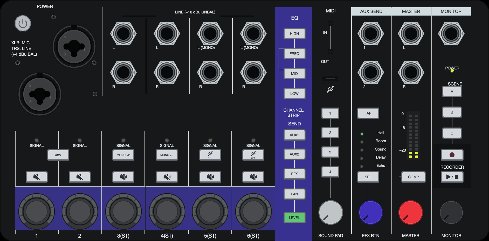
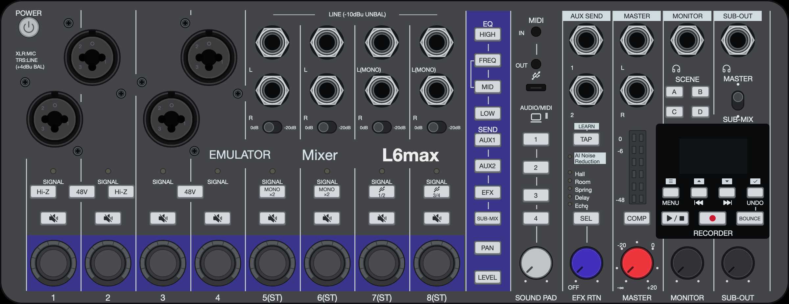
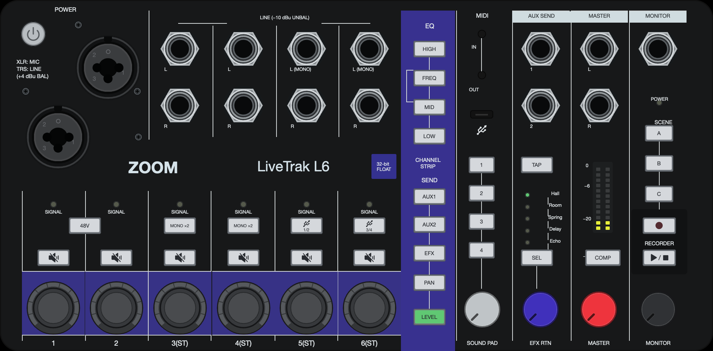

# Native L6/L6max UI

[Documentation index](../README.md)

The Rust/GPUI application composes the mixer from reusable native controls and displays the firmware framebuffer.
It starts one `l6max-dual` QEMU process containing the Cortex-M7 and panel
Cortex-M0, each with its own address space. Both CPUs use the same QEMU virtual
clock and communicate through a modeled internal UART.

## Run

For app bundles, see [firmware selection and packaging](../guides/macos-app.md).
The commands below describe development runs from a source checkout.

Build QEMU using [the board instructions](board.md), then run from
the repository root:

```sh
cargo run -p l6max-gui -- /path/to/qemu-system-arm
```

The application owns QEMU's lifetime. Automatic setup builds the pinned QEMU
when no executable is supplied. Use `--qemu PATH` or `L6_QEMU` to select an
existing executable. Optional arguments are
`--firmware-dir DIR`, `--logs DIR`, `--sd-image FILE`, and
`--timing paced|adaptive` (default: `paced`).
Firmware is supplied locally and excluded from Git.

The normal persistent visual UI creates a model-matched demo card on first
launch and reuses it thereafter. The L6max card is `emulator/state/sd-card.img`;
the L6 card is `emulator/state/sd-card-l6.img`. With `--state-dir DIR`, those
names are `DIR/sd-card.img` and `DIR/sd-card-l6.img`, respectively.
It is a 128 MiB FAT16 card with 16 KiB clusters, a copy of the selected local
firmware package at `/L6.BIN` or `/L6max.BIN` according to its detected model,
and four generated one-second mono 48 kHz / 16-bit WAV tones in
`/SOUND_PAD/PAD1` through `/SOUND_PAD/PAD4`.
Pad 1 also contains `SNARE8.WAV`, a 3.8-second stereo 48 kHz / 32-bit-float
sample. That format meets the L6max assignment requirement and is supported
by L6, which converts supported WAV rates to 48 kHz on assignment. See the
[L6max manual](https://zoomcorp.com/manuals/l6max-en/) and
[L6 manual](https://zoomcorp.com/manuals/l6-en/).
Existing cards are never repopulated or overwritten. `--sd-image FILE` selects
your own card; `--no-sd` starts without a card. Disposable `--volatile` runs and
headless tools retain explicit SD selection.

Try the samples in **Menu → Sound Pad → Sound Assign**. The generated demo
tones have been assigned and played through the L6max SAI1 path in the
headless audio smoke; see [audio](audio.md) for the trace and WAV-backend
details.
The original package is version 1.10, so use **Menu → System → Firmware →
Firmware Update** to try reinstalling it; a newer-version startup prompt is not
expected. Select **Execute**, hold **Power** for about 3.5 seconds and release.
When the display goes blank, click **Power** again. The standard persistent visual UI
automatically enables the replacement installer on power-on. On first boot,
complete Date/Time followed by Battery Type before opening the menu. Persistent
state retains those settings and the panel RTC across restarts. A freshly
created card can also show the firmware's “New card detected — Test the card?”
notification on first insertion.

To create another populated card, including one with a locally patched L6 or
L6max package:

```sh
cargo run -p l6fs -- card demo /path/to/card.img --firmware-package /path/to/L6max.bin
cargo run -p l6max-gui -- --sd-image /path/to/card.img
```

Flash and the RTC backup domain persist in `emulator/state/`. Select a device
with `--state-dir DIR`, or use `--volatile` to discard storage on exit. See the
[nonvolatile storage map](storage.md) for version records,
settings banks, calibration, and restart validation.

The standard persistent visual UI enables a Rust replacement for the
unavailable SD installer for either detected model; headless tools enable it
with `--update-bootloader`. It runs before QEMU starts. It acts only on a
pending update record in persistent NOR and reads the model-matched `L6.BIN` or
`L6max.BIN` from the attached SD image. L6's main and panel images are placed
into their installed NOR slots and its resource region is written to separate
persistent resource flash. Restart the app with the same state and SD after
update preparation. The installer preserves the bootloader region,
calibration, and settings; the actual main firmware performs panel programming.
This replacement models the update path for emulator validation; physical
bootloader behavior remains unverified. See the
[firmware update map](../firmware/updates.md) for checks and limits.

Use `--usb` to expose the firmware's three USB MIDI ports through CoreMIDI on
macOS or the ALSA sequencer on Linux. The [SD and USB guide](usb.md) describes card-image
creation, host file transfers, controller wiring, validation and current limits.

The initial window follows each model's body proportions: approximately
942×465 for L6 and 1200×464 for L6max. The L6 ratio comes from the manual's
419.3×206.8 faceplate outline. This keeps the L6 narrower while
rendering shared-size hardware at a comparable on-screen scale. Resizing
scales the panel, LCD, button hit zones, and encoder zones together. macOS
constrains the content aspect ratio; the minimum content size is 600×296 for
L6 and 600×232 for L6max.

L6 panel positions and control proportions follow the front-panel vector
drawing in the [official L6 operation manual](https://zoomcorp.com/documents/3263/E_L6.pdf).
The lower channel knob fields and their horizontal boundary lines follow that
drawing as well. All L6 1/4-inch TRS channel and output jacks share one size.
The L6max panel keeps its existing layout rather than being re-derived from
its manual.
Status appears in the native title bar. Closing the window quits the app and
stops/reaps QEMU. Application quit explicitly shuts the guest down.

## Display transport

Rust creates inherited Unix socket pairs for typed input/display messages and
QMP management. The `qapi` crate handles QMP.

Two completed 1 KiB display frames are shared with the UI. On macOS the
segment is created with `shm_open` and immediately unlinked; on Linux it uses
`memfd_create`. The descriptor identifies a kernel memory object. QEMU owns
guest RAM privately.

For L6max, SPI/eDMA transfers update the OLED. QEMU consumes those transfers into display controller RAM. Completed
transfers publish a frame slot and generation notification. The slot stays
immutable until Rust copies it and acknowledges consumption. When both slots
are occupied, the producer coalesces pending completed frames. The GPUI frame
tick drains notifications and paints the newest frame. L6 has no display:
QEMU closes its inherited frame descriptor and does not decode its transfers
as OLED traffic. Its resource-flash path through LPSPI3 at `0x403a0000` remains enabled.

## Native panel components

The panel uses reusable GPUI components in `emulator/gui/src/components/`: native canvas
encoders and colored analog knobs, buttons with text or icons, equal-sized
switches, sockets, indicator LEDs, labels, and dividers. `components/layout.rs` defines
shared channel widths, control rows, and a common knob baseline. Rendering and
input hit zones consume the same regions. Reference positions use one common
body-origin translation for drawing, input, and LCD placement. The firmware display remains a
128×64 buffer with a 2:1 aspect ratio.

Small icons come from [Lucide](https://lucide.dev/) and
[Phosphor](https://github.com/phosphor-icons/core) and are embedded at compile
time using GPUI's cached SVG masks. The pinned revision and licenses are in
[assets/icons](../../emulator/gui/assets/icons/README.md). No manufacturer logo, traced panel SVG,
or product photograph is bundled. The development profile optimizes
GPUI and its icon renderer while retaining application debug assertions and
symbols.

The renderer dispatches to separate `components/panel/l6.rs` and
`components/panel/l6max.rs` views; their reusable drawing helpers live in
`components/panel/shared.rs`, alongside the common controls and knobs. The L6
faceplate has six channels, a channel-strip selector, MIDI, AUX SEND, MASTER,
and MONITOR sections, with no LCD. The L6max retains its eight-channel layout,
SUB-OUT section, and recorder LCD. Native macOS text requires the `font-kit`
feature on `gpui_platform`. Shared socket components use the same rendered
physical size on both model windows; all L6 channel and output 1/4-inch jacks
share one diameter.

Both panels can be rendered through GPUI's headless Metal renderer without
opening an app window. Captures use each model's normal window proportions and
scale. From the repository
root, run:

```sh
cargo run -p l6max-gui --features 'gpui_platform/runtime_shaders,headless-screenshots' -- \
  --render-panel l6 --output docs/images/l6-panel-headless.png
cargo run -p l6max-gui --features 'gpui_platform/runtime_shaders,headless-screenshots' -- \
  --render-panel l6max --output docs/images/l6max-panel-headless.png
cargo run -p l6max-gui --features 'gpui_platform/runtime_shaders,headless-screenshots' -- \
  --render-panel l6 --powered-off --output docs/images/l6-panel-powered-off.png
```

The screenshots below come from those model-specific panel components.
The L6's removable center wordmark and `32-bit FLOAT` badge stickers are not
part of the faceplate and are omitted from the rendering.





The optional `--powered-off` flag renders the L6 panel with its virtual POWER
lamp off:



### Indicator surface

The panel uses a serial LED matrix driven by SPI1 and GPIO. The host receives
sampled LED levels over the panel socket and retains the latest eight rows.
QEMU integrates pin on-time over a 33 ms virtual-time window. The renderer
uses model-specific mappings for rings, buttons, effects, scenes, sound pads,
SIGNAL lamps, and MASTER meters; see [controls and indicators](controls.md).

Dragging a knob upward or right raises its level; downward or left lowers it.
The first movement locks the drag axis until release. Scrolling also adjusts
the knob, retaining fractional trackpad input. The cursor is an open hand over
a knob and a closed hand while dragging. Firmware computes the ring output,
including its mode-dependent pattern. Ring segments render measured PWM
brightness, normalized against captured full-mask endpoint readings (per
segment for L6 and per scan row for L6max). The renderer converts that duty to display
color with a linear-light blend. It does not add a separate persistence-of-
vision gain: the sampled duty already represents the LED's on-time fraction.

The L6 and L6max MASTER meters use their model-specific panel outputs. Their
left and right columns respond independently in the stereo playback scenarios.

- L6 Play/Stop and TAP illumination, L6max Bounce illumination, and logical
  LED 32 have no verified visual assignments. L6 sound-pad
  playback lamps are mapped and verified in the [control wiring
  findings](controls.md#main-gpio-controls).
- Audio-driven SIGNAL transitions remain untested.

Control bounds come from the shared layout specification. All switches use the
same physical dimensions, channel controls share row baselines, and all thirteen
knobs are aligned. The recorder display preserves its pixel aspect ratio and
pale blue tint. Encoder rings follow the GPIO indicator surface and render its
PWM brightness. Status lamps with verified model-specific mappings follow
their corresponding panel data.

GPUI is pinned to a Zed revision; macOS builds require Xcode's Metal Toolchain
component.

## Input and timing

Button down/up and encoder commands enter QEMU's device event loop. Button
minimum duration and release gaps use guest virtual time. The default minimum
is 50 ms. Physical Up maps to panel row 5, column 4; Down maps to row 4,
column 4. Encoder steps become quadrature GPIO transitions.

The four dB switches and MASTER/SUB-MIX toggle persistent GPIO state on a
click. Mouse release does not undo their position. The remaining controls
produce momentary closures. Input IDs 0–6 retain the recorder mapping; matrix
IDs are `7 + row * 5 + column`, with navigation aliases using their original
IDs. ID 47 is MASTER/SUB-MIX, 48 is TAP, and 49–52 are the sound pads.
ID 53 is Power. On L6max it is an active-high MAIN GPIO2 bit 25 input;
firmware handles debounce, long-press recognition, and shutdown. Hold it for
about 3.5 seconds and release. L6 uses a board-level cutoff after a 500 ms
press because its firmware shutdown path is not yet modeled. The L6max board
power-hold output, GPIO3.3, determines the off transition after cleanup. The UI stops QEMU, blanks the display and LEDs, and keeps the window
open. Click Power again to start with the same flash, RTC and SD card, applying
any prepared update. Switch and analog knob positions are retained across
the cycle. `--volatile` discards device storage at power-off. See the
[power lifecycle](power.md) for evidence and tests.

SOUND PAD, EFX RTN, MASTER, MONITOR, and SUB-OUT gestures set main ADC1
channels 5, 6, 4, 3, and 7 respectively. Samples range from 0 to 1023 and
start at 512; gesture steps change them by 32 counts. These finite-travel
knobs use the same scroll and drag handling as the channel encoders. Their
Native position marks rotate with simulated shaft position. The firmware applies
its existing filtering and scaling to the ADC readings.

Runtime command kind 6 sets an ADC sample using the physical channel as
target. Reply kind `0x80000007` reports a changed sample after the firmware
reads the completed conversion. The board-ID ADC channels are excluded from
this command.

Channel encoders emit quadrature transitions in guest time. A longer turn can
queue multiple detents. LED levels are integrated over a 33 ms scan window.

Panel runtime notifications include a 33 ms virtual-clock heartbeat
(`0x80000008`). Input tests use it for guest-time waits; timestamps on changed
LCD frames do not advance while the display is static.

Panel TIM2 drives input scanning and firmware debounce. The engine uses
single-threaded TCG with `-icount shift=2,align=on,sleep=on`; each instruction
advances the shared virtual clock by 4 ns. QMP pause freezes both chips and
device timers. Instruction timing is an emulator pacing model rather than a
measurement of physical MCU cycles.

Enabling UART receive interrupts during panel startup asserts the interrupt if a
byte is already pending.

Both CPUs share panel flash programming and reset state. The modeled ROM
update protocol writes executable panel flash, verifies it, and restarts the
panel application. Guest-requested chip resets remain local to that chip.

## CPU consumption

The emulator executes firmware on two modeled processors. CPU use depends on
the selected model, firmware activity and timing mode.

## Validation

Use the [test driver](../development/testing.md) for headless and GPUI
scenarios. Both use the production `PanelFeed` and `PanelData`; GUI tests also
exercise hit testing and event dispatch.

```sh
cargo run --offline --locked -p l6test -- run --case l6-input-sweep --model l6 --config smoke.local.toml
cargo run --offline --locked -p l6test -- run --case l6max-input-smoke --model l6max --config smoke.local.toml
cargo run --offline --locked -p l6test -- run --case panel --model l6 --backend gui --config smoke.local.toml
cargo run --offline --locked -p l6test -- run --case panel --model l6max --backend gui --config smoke.local.toml
```

The [current status](../development/current-status.md) lists qualification
limits. For offscreen panel images, see [`l6test capture gui`](../development/tools/l6test.md#capture-the-live-emulator-gui-without-a-display-server).

## Limitations

- GPUI requires an owned image: rendering copies the 1 KiB frame and converts
  its pixels. The display path is not zero copy through the GPU.
- UART byte timing and SPI transfer timing are approximations.
- Instruction-count timing does not model hardware instruction cycle costs.
- Physical audio routing, analog input, and output fidelity remain unverified;
  see [audio emulation](audio.md).
- Several peripherals remain incomplete; see the [board model](board.md).
- QEMU's Rust crates are internal Meson device APIs rather than a complete
  system embedding interface. The board model remains C; the UI, lifecycle,
  protocol, diagnostics, and package tool are Rust.
